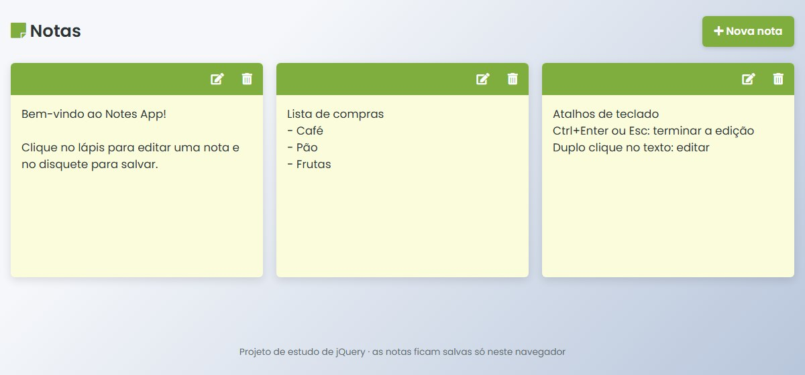

# Notes App (jQuery)

Bloco de notas simples que roda direto no navegador.

**Demo:** https://maksoud.dev/notes-app-jquery/



## Sobre

Projeto de estudo feito em 2022 para praticar jQuery: criar elementos, tratar eventos e manipular o DOM sem nenhum framework. É HTML, CSS e jQuery puro, sem etapa de build.

## Funcionalidades

- Criar, editar e remover notas
- Notas salvas no `localStorage` (continuam lá depois de recarregar a página)
- Notas de exemplo na primeira visita e botão para carregá-las de novo quando a lista estiver vazia
- Mensagem de lista vazia e aviso rápido ao salvar ou remover
- Texto sempre exibido como texto puro (HTML digitado não é interpretado)
- Atalhos de teclado: `Ctrl+Enter` ou `Esc` terminam a edição; duplo clique no texto abre a edição
- Layout responsivo, com botões sempre visíveis e fáceis de tocar no celular

## Tecnologias

- HTML5 e CSS3 (grid, variáveis CSS)
- jQuery 3.5.1 (arquivo local)
- Font Awesome 5 (ícones) e fonte Poppins (Google Fonts)

## Estrutura de arquivos

```
notes-app-jquery/
├── index.html           # estrutura da página
├── style.css            # estilos e layout responsivo
├── script.js            # lógica das notas (jQuery + localStorage)
├── jquery-3.5.1.min.js  # jQuery local
├── favicon.ico
└── screenshot.jpg       # imagem usada neste README
```

## Como rodar

Basta abrir o `index.html` no navegador.

Se preferir usar um servidor local:

```bash
npx serve .
# ou
python -m http.server 8000
```

Depois acesse o endereço mostrado no terminal (no Python, http://localhost:8000).

---

Outros projetos: https://maksoud.dev/projetos/
